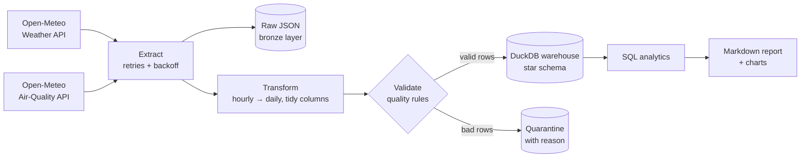
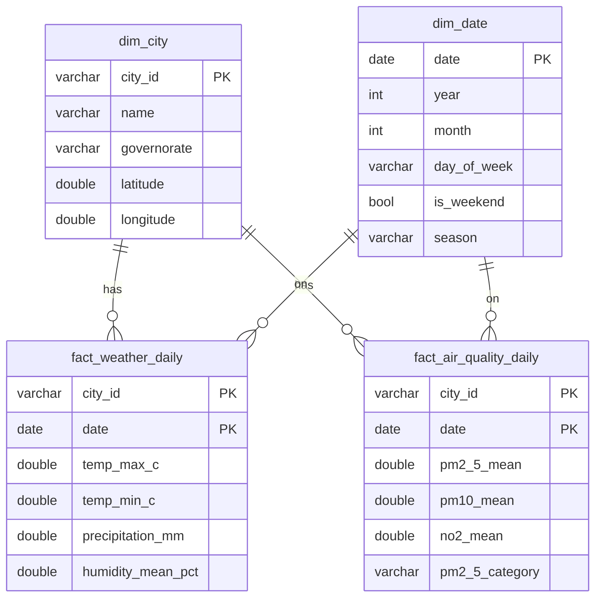
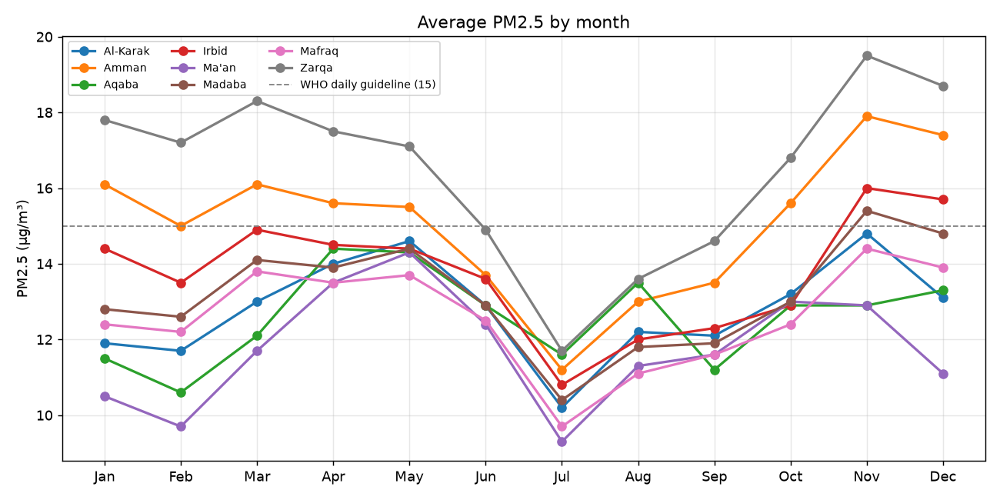

# Jordan Climate & Air-Quality Data Pipeline 🌍

[](https://github.com/Mohdsuhail06/jordan-climate-pipeline/actions/workflows/ci.yml)


An end-to-end **ETL pipeline** that collects three years of daily **weather** and **air-quality**
data for 8 Jordanian cities, checks its quality, and loads it into a **DuckDB star-schema
warehouse** ready for analytics.

> **Result of the latest run:** 17,536 rows loaded (8 cities × 1,096 days × 2 datasets),
> 0 rows quarantined, about 40 seconds end to end. 👉 [Full analytics report](reports/REPORT.md)

## Architecture



| Step | What it does | Code |
|---|---|---|
| **Extract** | Calls two public APIs per city, in yearly chunks. Retries automatically on rate limits (429) and server errors (5xx) with exponential backoff. Saves every raw response so runs can be replayed. | [`extract.py`](src/climate_pipeline/extract.py) |
| **Transform** | Renames fields, fixes types, aggregates 24 hourly pollution readings into daily mean/max, drops days with fewer than 18 hours of data, adds the EPA PM2.5 category. | [`transform.py`](src/climate_pipeline/transform.py) |
| **Validate** | 15 data-quality rules plus a duplicate check (nulls, physical ranges, `min ≤ max`, `PM2.5 ≤ PM10`, duplicates). Bad rows are **quarantined with the reason**, never silently dropped. | [`validate.py`](src/climate_pipeline/validate.py) |
| **Load** | Idempotent upserts into a star schema: running the same dates twice never creates duplicates. Every run is audited in `pipeline_runs`. | [`load.py`](src/climate_pipeline/load.py) |
| **Orchestrate** | One failing city does not stop the run: it is recorded and the run is marked `partial`. | [`pipeline.py`](src/climate_pipeline/pipeline.py) |
| **Analyze** | Six SQL queries + three charts written to `reports/`. | [`report.py`](src/climate_pipeline/report.py), [`sql/`](src/climate_pipeline/sql) |

### Warehouse schema



Plus two operational tables: `pipeline_runs` (audit log of every run) and `quarantine`
(rejected rows, the rule they broke, and the original record as JSON).

## Key findings (2023–2025)



- **Zarqa has the most polluted air**: average PM2.5 of 16.5 µg/m³, above the WHO daily
  guideline on **49.5% of days**. Amman follows at 39.8%.
- **Clear seasonal pattern**: fine particles are lowest in **July** in every city and peak in
  **November–December** and in spring.
- **Dust storms**: on **13 September 2023** a dust event hit the south. Ma'an reached a daily
  PM10 of 241.5 µg/m³, the highest of all 8,768 city-days.
- **Rain cleans the air**: PM10 is **16% lower** on rainy days (26.1 vs 31.1 µg/m³).
- **Aqaba is the hottest city**: summer average 34 °C, peak of 48.1 °C.

## Quick start

Requires Python 3.11+.

```bash
git clone https://github.com/Mohdsuhail06/jordan-climate-pipeline.git
cd jordan-climate-pipeline
python -m venv .venv
.venv\Scripts\activate          # Windows  (macOS/Linux: source .venv/bin/activate)
pip install -e ".[dev]"
```

Run the pipeline (no API key needed) and build the report:

```bash
climate-pipeline run                                   # 2023-01-01 → 2025-12-31, all 8 cities
climate-pipeline run --start 2025-06-01 --end 2025-06-30 --cities amman irbid
climate-pipeline report                                # writes reports/REPORT.md + charts
```

Query the warehouse directly:

```bash
python -c "import duckdb; print(duckdb.connect('data/warehouse.duckdb').sql('SELECT * FROM pipeline_runs'))"
```

## Testing

65 tests, **98% coverage**. They use small hand-built payloads and an in-memory
database, so they run offline in a few seconds.

```bash
pytest --cov=climate_pipeline
ruff check . && ruff format --check .
```

GitHub Actions runs linting and the full test suite on Python 3.11, 3.12 and 3.13 for every push.

## Project structure

```
jordan-climate-pipeline/
├── src/climate_pipeline/
│   ├── config.py        # cities, API fields, default paths
│   ├── extract.py       # HTTP calls with retries, raw-file archiving
│   ├── transform.py     # JSON → tidy daily DataFrames
│   ├── validate.py      # data-quality rules + quarantine
│   ├── load.py          # DuckDB schema, upserts, run audit
│   ├── pipeline.py      # orchestration
│   ├── report.py        # analytics report and charts
│   ├── cli.py           # `climate-pipeline` command
│   └── sql/             # analytics queries
├── tests/               # pytest suite (offline)
├── reports/             # latest generated report
└── .github/workflows/   # CI
```

## Data source and limitations

- Weather: [Open-Meteo Historical Weather API](https://open-meteo.com/en/docs/historical-weather-api) (ERA5 reanalysis).
- Air quality: [Open-Meteo Air Quality API](https://open-meteo.com/en/docs/air-quality-api) (CAMS model).
- Data by [Open-Meteo.com](https://open-meteo.com/), licensed under [CC BY 4.0](https://creativecommons.org/licenses/by/4.0/).
- Both sources are **model estimates on a grid**, not readings from ground monitoring stations,
  so local hot-spots (e.g. next to a busy road) are smoothed out.

## License

[MIT](LICENSE) © 2026 Mohammed Suhail
