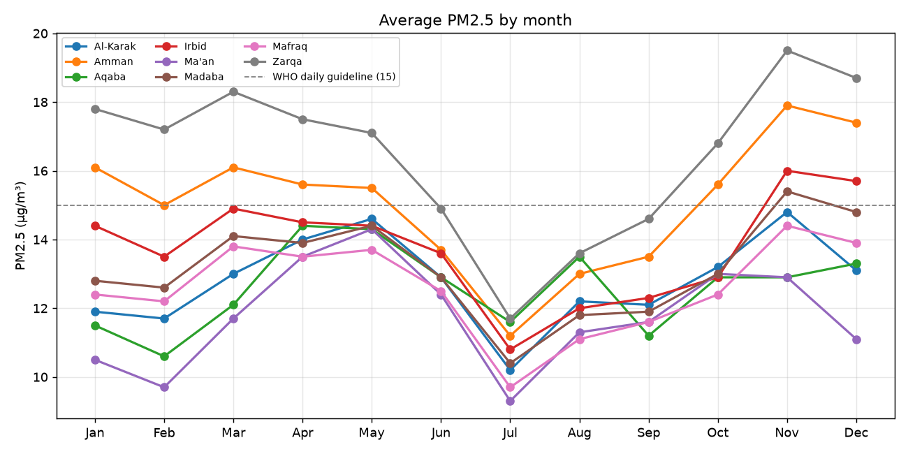
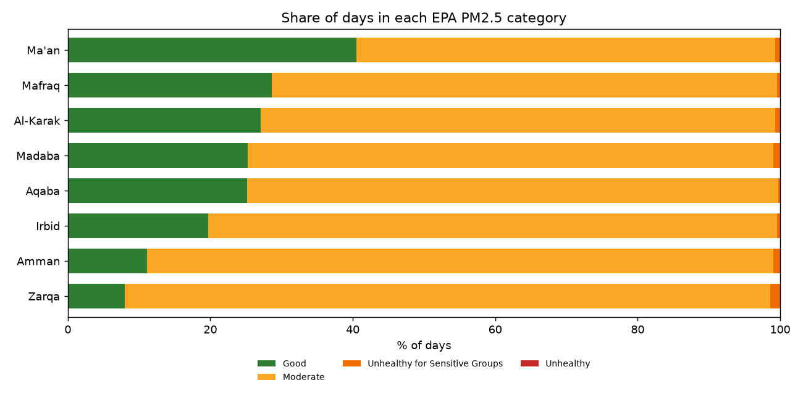
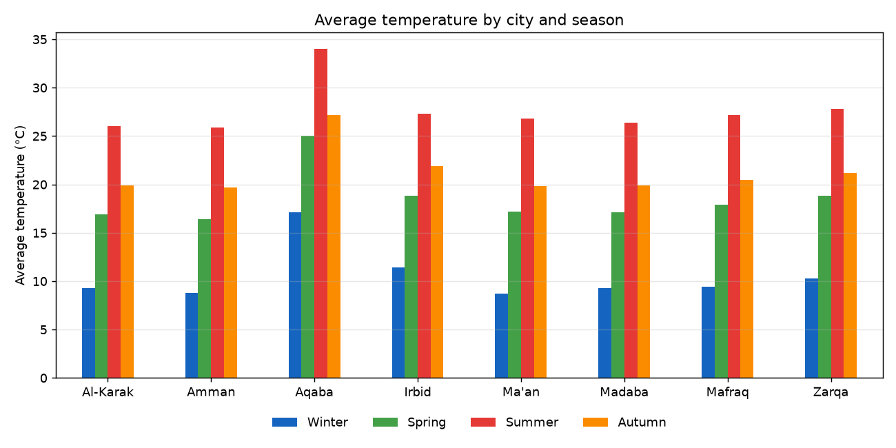

# Jordan Climate & Air Quality Report

Period: **2023-01-01 to 2025-12-31** · Weather rows: **8,768** · Air-quality rows: **8,768**

## City summary

`pct_days_above_who`: days with PM2.5 above the WHO daily guideline (15 µg/m³). `pct_unhealthy_days`: days above 35.4 µg/m³ (EPA *Unhealthy for Sensitive Groups* or worse).

| city | avg_temp_c | hottest_day_c | coldest_night_c | rain_mm_per_year | avg_pm25 | pct_days_above_who | pct_unhealthy_days |
| --- | --- | --- | --- | --- | --- | --- | --- |
| Zarqa | 19.5 | 45.0 | -2.5 | 123.0 | 16.5 | 49.5 | 1.6 |
| Amman | 17.7 | 41.0 | -2.7 | 251.0 | 15.0 | 39.8 | 0.9 |
| Madaba | 18.2 | 42.6 | -4.6 | 255.0 | 13.2 | 27.8 | 0.9 |
| Al-Karak | 18.1 | 41.1 | -3.8 | 223.0 | 12.8 | 25.1 | 0.8 |
| Ma'an | 18.1 | 40.3 | -2.8 | 62.0 | 11.8 | 22.2 | 0.7 |
| Irbid | 19.9 | 44.0 | -1.8 | 230.0 | 13.8 | 32.2 | 0.5 |
| Mafraq | 18.8 | 43.9 | -2.8 | 120.0 | 12.6 | 25.5 | 0.5 |
| Aqaba | 25.8 | 48.1 | 7.0 | 37.0 | 12.6 | 24.3 | 0.3 |

## Seasonal pattern of fine particles (PM2.5)

## How often is the air unhealthy?

## Temperature by season

## Ten dustiest days (highest PM10)

| city | date | pm10_mean | pm2_5_mean | category |
| --- | --- | --- | --- | --- |
| Ma'an | 2023-09-13 | 241.5 | 59.8 | Unhealthy |
| Al-Karak | 2023-09-13 | 214.6 | 53.8 | Unhealthy for Sensitive Groups |
| Aqaba | 2025-04-03 | 194.8 | 32.2 | Moderate |
| Aqaba | 2025-02-06 | 182.7 | 25.4 | Moderate |
| Aqaba | 2023-09-13 | 171.6 | 47.4 | Unhealthy for Sensitive Groups |
| Madaba | 2023-09-13 | 169.7 | 43.0 | Unhealthy for Sensitive Groups |
| Amman | 2024-10-27 | 168.2 | 46.2 | Unhealthy for Sensitive Groups |
| Zarqa | 2023-10-23 | 167.6 | 54.6 | Unhealthy for Sensitive Groups |
| Zarqa | 2024-10-27 | 167.0 | 46.8 | Unhealthy for Sensitive Groups |
| Zarqa | 2023-09-13 | 166.6 | 45.1 | Unhealthy for Sensitive Groups |

## Does rain clean the air?

| day_type | days | avg_pm25 | avg_pm10 |
| --- | --- | --- | --- |
| Dry | 8027 | 13.6 | 31.1 |
| Rainy (>= 1 mm) | 741 | 12.7 | 26.1 |
